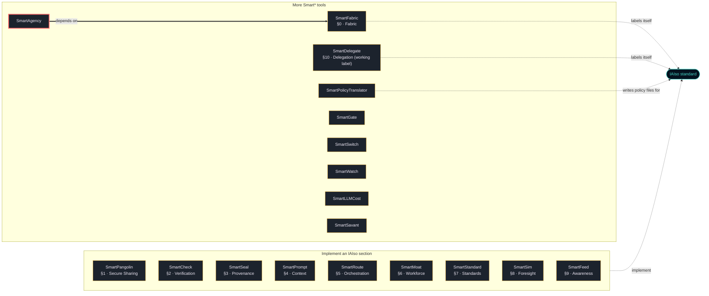

<!-- mcp-name: io.github.smarttasksorg/sf-smartagency -->
<h1 align="center">SmartAgency</h1>
<p align="center"><b>Signed contracts that say what an AI agent may do, a ledger to suspend and revoke them, and a monitor that enforces them on every action.</b></p>
<p align="center">
  Built on <a href="https://github.com/SmartTasksOrg/sf-smartfabric">SmartFabric</a> ·
  <a href="https://iaiso.org">IAIso</a> ·
  <a href="https://smarttasks.cloud">SmartTasks.cloud</a> ·
  <a href="#part-of-the-smart-family">the Smart* family</a>
</p>

---

## The problem

AI agents from several providers act on your systems. Each provider describes permissions its own way, if
at all. You cannot show what an agent was allowed to do, you cannot take a permission back everywhere at
once, and you cannot replace a permission set without leaving a gap or an overlap.

## What SmartAgency does

- **A contract per agent**, signed with Ed25519 by an issuer you trust. It names the agent; the actions it
  may or may not take (SmartFabric CIR verbs on resource paths, with wildcards); per-action limits on
  tokens, tool calls, planning depth and influence; SmartFabric pressure thresholds; forbidden sequences
  of actions; and a validity window.
- **A status ledger**: issue, suspend, resume, revoke single grants, revoke, or supersede a contract.
  Every entry is signed by the issuer and hash-chained to the one before. An edited, reordered or missing
  entry makes the ledger invalid, and the monitor then denies everything.
- **A monitor** that decides every action: `allow`, `deny` or `escalate`, with the reason. A deny grant
  in any contract wins, and the lowest limit applies. A session that completes a forbidden sequence is
  stopped (for example, read a secret and then call the network). The agent's SmartFabric pressure rises
  with its work: in the escalation zone a person must approve, and at release the agent is locked until a
  person resets it.
- **An audit record for every decision**, hash-chained and signed by the monitor's own key, so anyone with
  its public key can tell a real record from a fabricated one. There is an RFC 5424 syslog formatter for your
  SIEM.

The format is specified in [spec/SPEC.md](spec/SPEC.md) and pinned by 162 conformance checks in
`spec/conformance/`, so another implementation can be checked against this one.

## Install

```bash
python -m pip install sf-smartagency
sf-smartagency demo
```

Every file of `sf-smartagency` on PyPI is built and published by this repository's release workflow
(`.github/workflows/release.yml`, PyPI trusted publishing). Each file carries a provenance attestation
that names this repository and that workflow; PyPI shows it under "Verified details". The same workflow
records a GitHub attestation, which you can check with
`gh attestation verify <file> --repo SmartTasksOrg/sf-smartagency`. A release file without that
provenance is not ours, and neither is a package called `smartagency` (without `sf-`) on any registry.

Version 0.1.0 is the first release under this name. If pip cannot find it yet, that release has not
finished. Install from a clone instead (Python 3.10 or later):

```bash
git clone https://github.com/SmartTasksOrg/sf-smartagency
cd sf-smartagency
python -m venv .venv
. .venv/bin/activate          # Windows PowerShell: .\.venv\Scripts\Activate.ps1
python -m pip install .
sf-smartagency demo
```

It installs three dependencies: `sf-smartfabric` (the pressure model and the CIR verbs), `cryptography`
(Ed25519) and `jsonschema`.

## The demo

`sf-smartagency demo` runs one agent with one contract, in memory, with a fixed clock. It shows each kind
of decision: an allowed read; a tool the contract denies; an exfiltration sequence (read a secret, then
upload) stopped as a composite; limits on tokens and influence; pressure rising to escalation and release;
the lock until a person's reset; and revocation through the ledger. It ends with `demo OK`. Its issuer key
comes from a fixed, public seed, so never use it for anything real.

## Use it

```bash
# 1. an issuer key (the private key goes to the file, readable only by you; the registry entry is printed)
sf-smartagency keygen --out issuer.pem --name "Platform security team" > issuer-entry.json
#    put that entry in registry.json: {"schema": "smartagency.registry/1", "keys": [ ...entry... ]}

# 2. a contract: copy examples/contract.example.json, set "issuer" to your key id, edit, then
sf-smartagency validate contract.json
sf-smartagency sign contract.json --key issuer.pem --out contract.signed.json

# 3. issue it in the ledger (later: suspend, resume, revoke-grants --grants 0,3, revoke); each write prints the head
sf-smartagency ledger issue --ledger status.jsonl --registry registry.json --key issuer.pem --contract contract.signed.json

# 4. try one action (exit 0 allow, 1 deny, 3 escalate)
sf-smartagency check --registry registry.json --ledger status.jsonl --contracts contract.signed.json \
    --subject iaiso://agent/research-1 --verb invoke --resource tools/search --tool-calls 1 --audit audit.jsonl
```

`check` decides one action on its own, with no pressure history and no session. Use it to try a contract;
in front of a running agent, use a long-lived `Monitor` (below), which carries pressure and composite rules
from one action to the next.

**Keep the ledger's head somewhere else.** Every ledger write prints a head (`<seq>:<digest>`); so does
`sf-smartagency ledger verify`. Store it where the ledger's writer cannot change it (another system, a
ticket, a signed message) and pass it as `--anchor` (or `StatusLedger(..., anchor=...)`). A ledger replaced
by an older valid copy is then refused; without an anchor, only a process that already read the newer
entries notices.

In Python, keep one `Monitor` in front of the agent, so pressure and sessions carry from one action to the
next:

```python
from sf_smartagency import AuditLog, Monitor, Registry, StatusLedger, keys

registry = Registry.from_file("registry.json")
audit = AuditLog("audit.jsonl", signer=keys.load_private("monitor.pem"))   # the monitor's own key signs each record
monitor = Monitor(registry, StatusLedger(registry, "status.jsonl", anchor=saved_head), audit)
monitor.add_contract(signed_contract)            # returns a list of problems; empty means loaded
d = monitor.check("iaiso://agent/research-1", "invoke", "tools/search", tool_calls=1, session="task-17")
if d.outcome == "allow":
    ...                                          # run the action
elif d.outcome == "escalate":
    ...                                          # ask a person first (for example with SmartGate)
```

`monitor.check_plan(agent, steps)` decides a whole plan in advance without changing any state. Paths and
verbs are compared exactly, so pass the monitor the same normalised path your host will act on: actions with
`.` or `..` segments, `%` escapes or upper-case verbs are refused as `invalid-action`.

## How it uses SmartFabric

The verbs in grants are SmartFabric's CIR verbs (or `x-` extensions). A contract's `limits.pressure` sets
the agent's SmartFabric `PressureConfig`. The monitor steps SmartFabric's own `PressureEngine` with each
allowed action's tokens, tool calls and depth, and uses SmartFabric's zones: escalation means a person
decides, and release means an atomic reset and a lock. With several contracts, the strictest
configuration applies. SmartAgency does not change SmartFabric's model; it decides when an agent may add
to it.

SmartFabric 0.5.x has no public way to give an engine an agent's current state, so the monitor sets the
engine's two state fields and reads them back. It checks this when it starts and on every step, and refuses
(`PressureStateError`) if the installed SmartFabric does not carry the state. The dependency is pinned to
`sf-smartfabric>=0.5.1,<0.6` for the same reason.

**Pressure lives in memory.** A `Monitor` keeps each agent's pressure, release lock and sessions in memory. A
restarted monitor starts every agent at zero and unlocked, which has the effect of a reset nobody approved.
Restart it only when a person would also reset the agents, or suspend their contracts in the ledger first.

## SmartAgency and SmartDelegate

[SmartDelegate](https://github.com/SmartTasksOrg/sf-smartdelegate) limits what an agent may do **for a
person**: a human lends one role they hold, for one task, with a short-lived token; it removes fields
before they reach the model, and keeps money budgets and approvals. SmartAgency limits what an agent may do
**at all, and how much**: a standing contract signed by the organisation, with per-action limits,
forbidden sequences and SmartFabric pressure. They do not call each other. A host that uses both asks
both, and runs an action only if both allow it:

1. `monitor.check_plan(agent, [step])`: SmartAgency, without changing any state;
2. SmartDelegate's check: records spend and rate, removes fields;
3. `monitor.check(...)`: SmartAgency adds the action to the agent's pressure and writes its audit record.

The two name things differently: SmartAgency subjects are `iaiso://agent/...` and its verbs are SmartFabric
CIR verbs (`query`, `invoke`, ...) or `x-` extensions, while SmartDelegate uses its own agent and action
names. Map them once in the host.

## Status

- **Version 0.1.1, experimental.** It contains the contract format, Ed25519 signing, the issuer registry,
  the status ledger, the monitor, audit records, a command line and the conformance vectors. It is Python
  only.
- **Published:** PyPI `sf-smartagency` (see Install). Nothing else is published.
- **Tested:** CI runs the tests and the 162 conformance checks on Python 3.10, 3.12 and 3.13, Linux, on
  every push and pull request (`.github/workflows/ci.yml`). Before release they passed on Python 3.13,
  Linux.
- **Not kept across restarts:** pressure, release locks and sessions (see "How it uses SmartFabric").
- **Not tested:** Windows and macOS; concurrent writers on network file systems (the ledger's lock file
  assumes a local file system); performance. No latency or throughput figure is claimed.
- **Origin:** the design comes from a SmartSignal design council. [docs/decisions.md](docs/decisions.md)
  says what was adopted from it, what was changed and why, and what was left out (all of the council's
  performance figures, which were not measured).
- **Security review:** two pre-release rounds by a separate AI reviewer that did not write the code: 12
  findings in the first (1 high, 6 medium, 5 low), and 4 more plus one regression in the second. All are
  fixed, with regression tests in `tests/test_review_fixes.py` (CHANGELOG). There has been no independent human audit.
  [docs/threat-model.md](docs/threat-model.md) says what is and is not defended. Report vulnerabilities as
  described in [SECURITY.md](SECURITY.md).

## Part of the Smart* family

<!-- smart-family:start -->
<!-- generated by fleet-docs from family.json; change family.json, not this block -->

18 open-source tools by SmartTasks Lab, each standalone, plus the [IAIso standard](https://github.com/SmartTasksOrg/IAISO). Every tool is on PyPI under its `sf-` name; a package without the `sf-` prefix is not ours.

| Tool | IAIso | What it does |
|---|---|---|
| [SmartPangolin](https://github.com/SmartTasksOrg/sf-smartpangolin) | §1 · Secure Sharing | Scan before you share. Stop leaking secrets into AI models, agents, and tools. |
| [SmartCheck](https://github.com/SmartTasksOrg/sf-smartcheck) | §2 · Verification | Check before you sign off. Catch the AI when it's confidently wrong. |
| [SmartSeal](https://github.com/SmartTasksOrg/sf-smartseal) | §3 · Provenance | Seal what you ship. A signed receipt so anyone can verify what they received. |
| [SmartPrompt](https://github.com/SmartTasksOrg/sf-smartprompt) | §4 · Context | Lint before you send. Bad prompt in, bad work out — and it's your name on it. |
| [SmartRoute](https://github.com/SmartTasksOrg/sf-smartroute) | §5 · Orchestration | Route only what you trust. Gate agents and tools with trust scores and guardrails. |
| [SmartMoat](https://github.com/SmartTasksOrg/sf-smartmoat) | §6 · Workforce | Know your moat. Score the tasks AI can't easily take — and widen them. |
| [SmartStandard](https://github.com/SmartTasksOrg/sf-smartstandard) | §7 · Standards | Standardize before you scale. One shared, auditable convention for AI-assisted work. |
| [SmartSim](https://github.com/SmartTasksOrg/sf-smartsim) | §8 · Foresight | Simulate before it hits you. See your role's task-by-task collapse sequence. |
| [SmartFeed](https://github.com/SmartTasksOrg/sf-smartfeed) | §9 · Awareness | Distill the firehose. A tight brief of only what moves your work. |
| [SmartFabric](https://github.com/SmartTasksOrg/sf-smartfabric) | §0 · Fabric | IAIso Fabric Protocol (IFP) — carry & enforce IAIso containment across a fleet of governed AI nodes. |
| [SmartDelegate](https://github.com/SmartTasksOrg/sf-smartdelegate) | §10 · Delegation (working label) | Delegate, don't hand over the keys. An agent never holds more than the human's role for the task: IAM for LLM agents. |
| [SmartPolicyTranslator](https://github.com/SmartTasksOrg/sf-smartpolicytranslator) | writes IAIso policy files | Translate natural-language regulation into REAL, schema-conformant IAIso policy files. |
| **[SmartAgency](https://github.com/SmartTasksOrg/sf-smartagency)** (this repository) | — | Signed contracts that say what an AI agent may do, a ledger to suspend and revoke them, and a monitor that enforces them on every action, with SmartFabric pressure limits. |
| [SmartGate](https://github.com/SmartTasksOrg/sf-smartgate) | — | Decision friction and a human override for AI agents: score each action, ask a person before risky ones, kill any action or agent with one logged call. |
| [SmartSwitch](https://github.com/SmartTasksOrg/sf-smartswitch) | — | A quorum kill switch for AI agent fleets: no single keyholder can halt the fleet or block a halt; every agent verifies the signatures itself and stops when cut off. |
| [SmartWatch](https://github.com/SmartTasksOrg/sf-smartwatch) | — | Coupling-density monitor for multi-agent systems: measures how densely agents talk to each other, raises graded alerts, and proposes or issues resets before coordination outgrows human oversight. |
| [SmartLLMCost](https://github.com/SmartTasksOrg/sf-smartllmcost) | — | Apples-to-apples LLM cost & performance benchmark — cost per successful task, reproducible. |
| [SmartSavant](https://github.com/SmartTasksOrg/sf-smartsavant) | — | A model-agnostic design council: stakeholder views and a juror merge per design-sprint phase, schema-checked adapter answers, exports (spec, stories, decision tree, trainset) and audits of council runs before anyone builds or trains from them. |



Thick arrow: the package requires the other one in its `pyproject.toml`. Dashed arrow: what the tool's README states about IAIso. A tool with no thick arrow does not depend on any other family package; each one installs and runs on its own.

<!-- smart-family:end -->

## Contributing, security, licence

[CONTRIBUTING.md](CONTRIBUTING.md) · [SECURITY.md](SECURITY.md) · [CODE_OF_CONDUCT.md](CODE_OF_CONDUCT.md) ·
Apache-2.0 ([LICENSE](LICENSE), [NOTICE](NOTICE)). SmartFabric, a dependency, has its own licence; see NOTICE.
